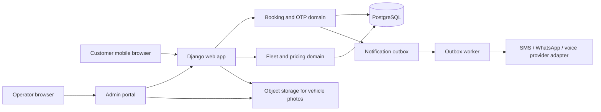
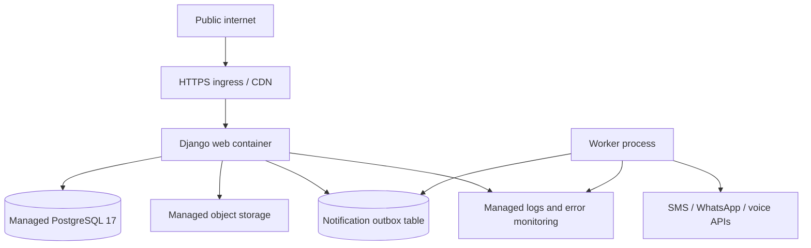

# Cab Service — High-Level Design

**Status:** Initial implementation baseline  
**Version:** 0.1  
**Date:** 9 November 2026

## 1. Purpose and scope

This document describes the Phase 1 architecture for a public cab-booking website and an operator admin portal. Phase 1 accepts phone-verified booking requests, keeps an auditable price snapshot, lets the operator manage vehicles/prices/bookings, and alerts the operator through a configurable delivery channel.

The first release is operator-assisted: a submitted request is **Pending confirmation** until the operator accepts it. It does not include automatic driver dispatch, live tracking, or online payments.

## 2. Architecture principles

- Use a modular monolith: one Django application and one relational database, with clear domain boundaries.
- Prefer server-rendered HTML and progressive enhancement so the booking journey remains usable on slow mobile networks.
- Persist the booking before attempting any external notification. Delivery failures must not lose a booking.
- Keep OTP/SMS, WhatsApp, voice, mapping, and object storage behind replaceable adapters.
- Use managed infrastructure for the public deployment; do not self-manage a database server.
- Keep secrets in the deployment secret store/environment, never in source control.

## 3. Proposed technology

- Python 3.13 and Django 5.2 LTS.
- PostgreSQL 17 for production; SQLite only for local development.
- Django templates and a small locally served stylesheet. JavaScript is optional for core booking actions.
- Django Admin with custom list/detail screens for operator workflows.
- A database-backed notification outbox and worker for retries; avoid introducing a separate message broker until volume requires it. The initial code includes the outbox and local development adapter; live provider delivery and the production worker are pending provider selection.
- Managed object storage for production vehicle photos; local media storage for development.
- Containerized deployment to a managed application host, with managed PostgreSQL, backups, secrets, logs, and monitoring.

## 4. Logical components

## 5. Domain modules and data ownership

- **Fleet:** vehicle categories, descriptions, capacities, active state, photos.
- **Pricing:** effective-dated outstation per-kilometre prices, derived round-trip rates, configurable local packages and waiting charges, and customer-visible fare terms. Every booking stores a price/currency/version and applicable local-terms snapshot; later edits do not change existing bookings.
- **Booking:** customer contact, trip type, route locations, exact doorstep pickup/destination addresses, optional landmarks, pickup/return times, selected vehicle, rate/minimum-fare snapshot, actual travelled kilometres, unique public reference, status, idempotency key, and timestamps.
- **Phone verification and customer access:** short-lived, single-use OTP challenges for new bookings and My Bookings access. Persist only OTP hashes; enforce expiry, attempt, resend, and per-phone/IP rate limits. My Bookings queries are scoped to the phone number verified in the active session.
- **Notifications:** outbox records with channel, destination, payload reference, attempt count, next retry, status, and provider response summary. Avoid storing OTPs or unnecessary personal data in notification logs.
- **Audit:** operator and timestamp for price, vehicle, notification configuration, and booking-status changes.

## 6. Main request flows

### Customer booking

1. Server renders one-way, round-trip, and local-trip search. Airport trips are not enabled in Phase 1.
2. Customer searches the route and date/time; server renders outstation vehicle cards with the per-kilometre rate/minimum fare, or local vehicle-package cards with duration/included kilometres/package fare.
3. Customer selects a vehicle and enters exact doorstep addresses, optional landmarks, and contact details.
4. Server snapshots the selected price and minimum fare or local package/terms, and creates an idempotent booking draft.
5. The OTP adapter verifies the submitted phone number. Live SMS delivery is deferred to the final integration stage; local development uses the console adapter.
6. In the same database transaction, the application creates an operator-notification outbox item. The customer sees status **Booked** and a booking reference. The owner is expected to confirm within 12 hours and then request a 10% advance.
7. The customer can authenticate to My Bookings by phone OTP, see only bookings for that phone, and cancel eligible future bookings. A cancellation within 24 hours of pickup records a ₹300 charge for deduction from the advance paid.
8. After the journey, the operator marks the booking Completed and records actual kilometres and, for local rides, waiting hours; the system calculates the final fare from the snapshotted package/rate and extras. A daily cleanup anonymizes customer personal data five days after completion.

### Operator management

1. Authorized operator signs in to the admin portal.
2. Operator reviews bookings and updates status with an audit record.
3. Operator manages fleet content and adds a new effective-dated price version.
4. Existing bookings retain their original quoted price snapshot.

## 7. Low-bandwidth experience

- Server-render the booking form and its main text; do not require JavaScript to view prices or submit the booking.
- Keep initial HTML/CSS/JavaScript transfer at or below 200 KB compressed, excluding images.
- Do not load map libraries, large analytics bundles, or web fonts on the initial page. Offer text-address entry as the baseline; load map assistance only when requested.
- Generate responsive small vehicle-photo variants; lazy-load images below the fold. Booking and price information must remain usable if photos fail.
- Preserve entered data on retry, make submission idempotent, and display clear sending/error states.
- Target usable booking content within 3 seconds on a simulated mobile network at 1 Mbps downlink and 400 ms RTT. Measure the target before release and monitor field performance after launch.

## 8. Security and privacy

- Enforce HTTPS, secure session cookies, CSRF protection, server-side validation, and authorization on every admin mutation.
- Use a supported admin authentication setup; restrict admin account creation and apply MFA where the selected identity provider supports it.
- Never put OTP values, provider secrets, or sensitive customer data into logs.
- Apply OTP expiration, attempt limits, resend cooldowns, per-phone/IP throttles, and one-time use.
- Validate uploaded image type and size; store production images in managed object storage.
- Run `manage.py purge_expired_booking_data` daily in production to anonymize completed booking personal data after five days and remove old customer OTP challenges and rate-limit records. Configure this with the hosting scheduler after deployment.
- Define data retention/deletion, privacy notice, terms, and any local transportation disclosures before public launch.

## 9. Reliability and operations

- Commit booking and outbox records atomically, then deliver notifications asynchronously.
- Retry transient provider failures with bounded exponential backoff and expose permanent failures in the admin portal.
- Use database backups and a documented restore procedure; monitor booking creation, OTP delivery, outbox backlog, application exceptions, and database health.
- Keep staging and production settings separate. Use environment-based settings and managed secrets.
- Use health checks and graceful deployment/rollback on the chosen host.

## 10. Deployment view

Run a web process and an outbox worker from the same versioned application image. Use managed PostgreSQL backups, object storage, and a secrets manager. Hosting vendor and region remain deployment decisions after launch geography and budget are confirmed.

## 11. Phase boundaries

- **Phase 1:** public booking, SMS OTP, OTP-protected My Bookings, customer status and cancellation, operator booking management/alerts, vehicle and photo management, effective-dated prices, audit records, public deployment. After OTP, the customer sees Booked; the owner confirms within 12 hours and then requests a 10% advance. A ₹300 cancellation charge within 24 hours of pick-up is deducted from the advance paid. A daily scheduled management command anonymizes completed booking personal data after five days.
- **Phase 2:** automated customer status notifications, service hours/areas and operational reporting.
- **Phase 3:** driver assignment and trip progress; location sharing only with consent.
- **Phase 4:** online payment, receipts, refunds, and reconciliation.
- **Later:** scale-based dispatch optimization, multi-area support, localization, and native apps if justified.

## 12. Decisions still required

- Launch country/city and the corresponding SMS/WhatsApp/voice provider and sender requirements.
- Pricing: admin-set per-vehicle one-way rupees/km; round-trip is ₹1/km lower; minimum billable distances are 130 km and 250 km respectively. Local packages have admin-set duration, included distance, and price; excess distance uses the configured local rate (₹1/km by default), with optional carrier luggage at ₹150. Waiting is charged per hour for local and one-way trips at the snapshotted Sedan/SUV category rate, and is excluded from round trips. Local defaults include toll, state tax, AC, driver allowance, GST/Tax, parking, and two bags; night allowance is excluded.
- Distance estimate: not needed to create the initial Phase 1 request. The operator enters actual travelled kilometres after the journey; a map provider can be added later if pre-booking route estimates are needed.
- Whether Phase 1 operator alerts use SMS, WhatsApp, voice, or multiple channels, and the alert destination(s).
- Immediate vs scheduled bookings, service boundaries, lead times, operating hours, and cancellation rules.
- Production hosting vendor/region, domain, brand, and final privacy/transport disclosures.
